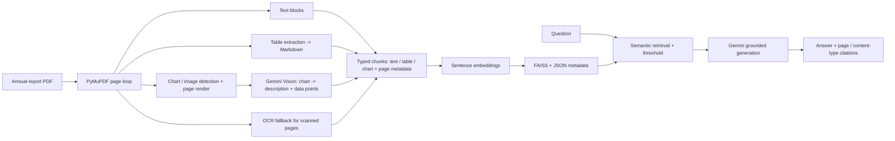

# AI Financial Risk & Investment Copilot

## Module 4 — Multimodal RAG + LLM Financial Assistant

This independent Python service makes annual reports searchable and explainable. It reads **text, tables and charts/graphs** from PDFs. It is a decision-support component, not investment advice and never guarantees an outcome.



## Why RAG?

Gemini alone can use general knowledge and may invent company facts. Retrieval-Augmented Generation (RAG) finds relevant passages first, then supplies only those passages to Gemini. An embedding is a numeric representation of meaning; similarity search finds content semantically related to the question. FAISS provides fast local similarity search and the accompanying JSON file maps each vector back to its company, document, page, chunk ID, content type and text.

## How tables and charts are handled (new)

A plain text extractor loses table structure and cannot see graphs. Each page is therefore processed in three passes:

| Content | How it is extracted | How it is stored |
| --- | --- | --- |
| **Text** | PyMuPDF text blocks, overlapping word chunks (150-word overlap by default) | `chunk_type: "text"` |
| **Tables** | PyMuPDF `page.find_tables()` (with `pymupdf4llm` as layout-aware fallback), converted to Markdown so rows/columns/headers survive. A table is kept as **one chunk** (large tables split by rows, header repeated) | `chunk_type: "table"` |
| **Charts / graphs / images** | Embedded images and vector-drawing regions are cropped/rendered to PNG, then sent to **Gemini Vision** with a prompt that asks for: chart type, title, axes, series, key values and trend. The returned description is indexed as text | `chunk_type: "chart"`, plus `image_ref` |
| **Scanned pages** | If a page has almost no text layer, it is rendered and OCR'd (RapidOCR) | `chunk_type: "text"`, `ocr: true` |

Every chunk keeps `company`, `document`, `page`, `chunk_id` and `chunk_type`, so an answer can say, for example, *"Table on page 42"* or *"Chart on page 17"*.

Chart descriptions are generated by a model, so they are marked `source: "vision_generated"` and the final answer should be treated as "needs verification against the original page". At query time, the cited page can optionally be rendered and sent to Gemini together with the question (`VERIFY_WITH_PAGE_IMAGE=true`) so numbers are checked against the actual picture.

## Layout

```text
app/                 FastAPI service, PDF processor (text/table/chart), FAISS RAG engine, Gemini layer (text + vision)
data/documents/      uploaded PDFs (gitignored)
data/indexes/        persisted FAISS index and metadata (gitignored)
data/page_images/    rendered chart/page PNGs used for vision + verification (gitignored)
scripts/             local ingestion helper
tests/               extraction, table, chart, retrieval, LLM safety, and API-contract tests
```

## Setup and run

```bash
python3 -m venv .venv
source .venv/bin/activate             # Windows: .venv\Scripts\activate
pip install -r requirements.txt
cp .env.example .env
uvicorn app.main:app --reload
```

Set `GEMINI_API_KEY` in `.env`. It is needed for generated explanations **and** for chart analysis during ingestion. Without a key, text and table indexing and retrieval still work, charts are skipped (logged), and `/query` returns `answer_mode: "retrieval_only"`.

Environment variables:

| Variable | Purpose |
| --- | --- |
| `GEMINI_MODEL` | model for grounded answers |
| `GEMINI_VISION_MODEL` | model used to describe charts (must be multimodal) |
| `EMBEDDING_MODEL` | sentence-embedding model |
| `DOCUMENT_STORAGE_PATH`, `VECTOR_STORE_PATH`, `IMAGE_STORAGE_PATH` | storage folders |
| `TOP_K`, `SIMILARITY_THRESHOLD` | retrieval settings |
| `ENABLE_TABLE_EXTRACTION` | `true` by default |
| `ENABLE_CHART_ANALYSIS` | `true` by default; set `false` to avoid vision API cost |
| `MIN_IMAGE_SIZE_PX` | ignore logos/icons smaller than this (default 150) |
| `MAX_CHARTS_PER_DOCUMENT` | cost guard for vision calls |
| `OCR_MIN_CHARS` | page below this many characters is treated as scanned |
| `VERIFY_WITH_PAGE_IMAGE` | send cited page image to Gemini at query time |

No credential is committed.

## API contract

| Endpoint | Purpose |
| --- | --- |
| `GET /health` | service readiness |
| `POST /documents/upload` | upload and immediately index a PDF (text + tables + charts) |
| `POST /documents/ingest` | index an existing safe filename from `data/documents` |
| `GET /documents` | list indexed documents with counts of text / table / chart chunks |
| `POST /query` | retrieve evidence and generate a grounded response |

Upload an annual report:

```bash
curl -X POST http://127.0.0.1:8000/documents/upload \
  -F 'file=@TCS_Annual_Report_2025.pdf' \
  -F 'company=TCS' \
  -F 'document=TCS Annual Report 2025'
```

Query it (optionally restrict to content types):

```bash
curl -X POST http://127.0.0.1:8000/query \
  -H 'Content-Type: application/json' \
  -d '{"query":"How did revenue change over the last 5 years?", "company":"TCS", "top_k":5, "chunk_types":["table","chart","text"]}'
```

For a company comparison, send `"companies":["TCS","Infosys"]` instead of `company`; the service retrieves top-K evidence separately for each company and labels every result with its source company.

The response includes `answer`, `grounded`, `answer_mode`, page-level `sources`, and `retrieved_context`. Each source has `company`, `document`, `page`, `chunk_id`, `chunk_type` (`text`/`table`/`chart`) and `retrieval_score`. Node/Express can call this endpoint directly and pass the JSON to the Next.js frontend. Its own risk, trend, or sentiment output can be included in `module_context`; that context is labelled separately from document evidence.

## Testing and evaluation

```bash
pytest -q
```

Tests use fake embeddings and a fake vision client, so no Gemini key is required. Add test PDFs containing (a) a simple table, (b) a bar chart, (c) a scanned page. For formal evaluation, save a small question set with expected document/page/content-type, then record the retrieved pages, scores, answer, and a human groundedness judgement. Do not fabricate relevance or faithfulness scores.

`scripts/evaluate_retrieval.py` writes that retrieval record from a JSONL question file (`question`, `expected_pages`, optional `company`, optional `expected_chunk_type`); human reviewers can then add generated-answer and groundedness assessments.

## Limitations and next steps

- Chart values are read by a vision model, so they are approximate; always check the cited page. Exact figures are best taken from the accompanying table or text.
- Tables without ruling lines, merged cells or multi-page tables may be extracted imperfectly.
- Vision calls add cost and ingestion time; use `MAX_CHARTS_PER_DOCUMENT` and `MIN_IMAGE_SIZE_PX`.
- Future work: hybrid keyword + semantic search, reranking, multi-page table stitching, structured financial-statement parsing, PostgreSQL metadata, and evaluation datasets.

## Viva summary

RAG means **retrieve first, generate second**. Top-K is the number of most similar chunks returned. The report is converted to three kinds of searchable chunks: **text** (direct extraction), **tables** (extracted as Markdown, so structure is kept) and **charts** (Gemini Vision turns each graph into a written description with numbers and trend). All three are embedded, stored in FAISS with page metadata, and cited back to the original page. FastAPI exposes this as a small, independently deployable service for the central Node.js backend.
